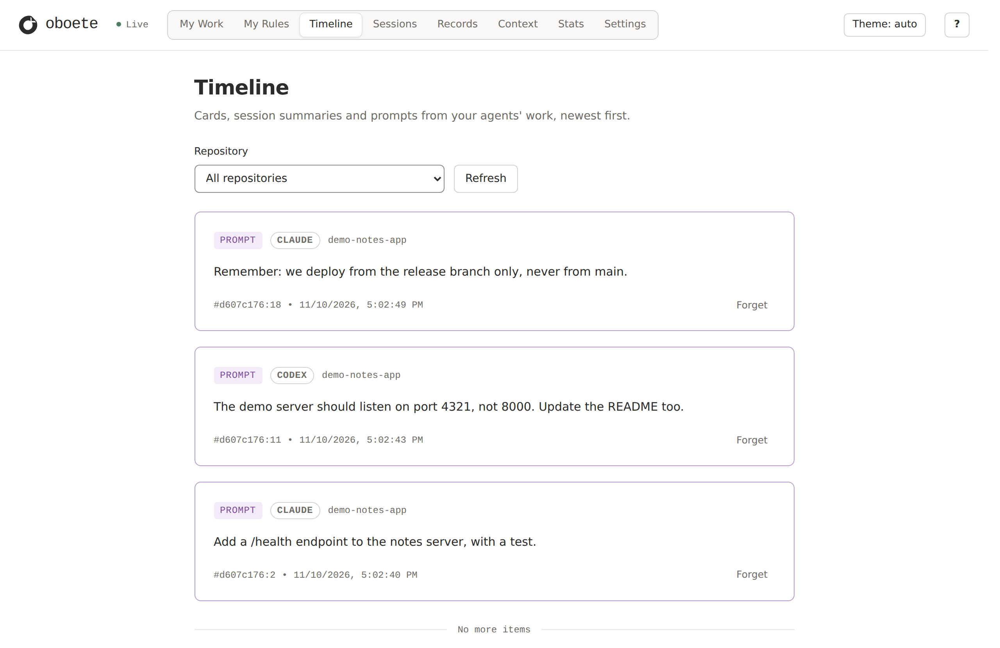
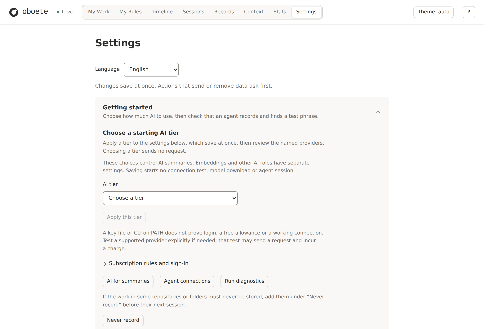
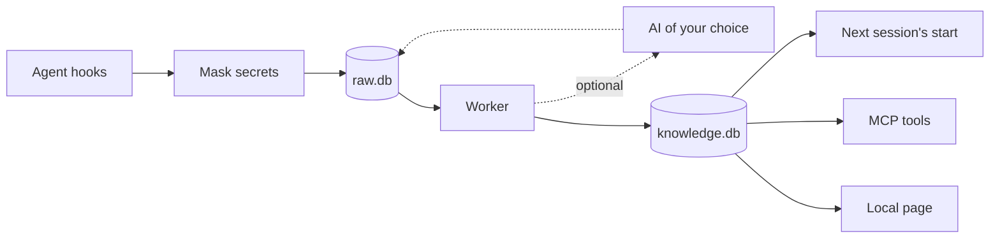

<p align="center">
  <picture>
    <source media="(prefers-color-scheme: dark)" srcset="assets/brand/logo/oboete-logo-light.svg">
    
  </picture>
</p>

<p align="center"><em>コーディングエージェントは、セッションをまたぐと忘れます。oboete が、あなたのマシンの中で覚えておきます。</em></p>

<p align="center">
  <a href="https://github.com/ojungo69/oboete/actions/workflows/ci.yml"></a>
  <a href="LICENSE"></a>
  
</p>

<p align="center"><a href="README.md">English</a> | <b>日本語</b></p>

**oboete**（覚えて）は、コーディングエージェントの作業を記録する Rust 製の単一バイナリです。記録はあなたのディスク上の SQLite ファイルに置き、次のセッションには前回の続きを渡します。記録は、ターミナルから、エージェント自身から（MCP）、ローカルの画面からも検索できます。AI による要約かオンラインの埋め込みを自分でオンにするまで、oboete 自身はどこにも何も送りません。エージェントに渡した内容は、そのエージェント自身の会話の一部になります。

**Claude Code**・**Codex**・**Grok Build** で使えます。この 3 つは作者が毎日使っています。Cursor・OpenCode・Antigravity・Pi 向けのアダプタも実装とテストは済んでいますが、実際のセッションではまだ使われていません。

下は、前日に Claude Code と Codex が作業したリポジトリで、翌日に Claude Code の新しいセッションを始めたところです。AI が要約した部分はありません。記録されていた内容そのものです。

```console
$ claude
## Owner's directives
- 2026-11-10 (unverified) "Remember: we deploy from the release branch only, never from main."
## Last exchange
- prompt: Remember: we deploy from the release branch only, never from main.
- reply: Noted: deploys go out from the release branch only, never from main.
## Files touched
- README.md
- src/server.py
## As of
2026-11-10 08:02 UTC

oboete: 記憶は有効です。このリポジトリの直近の状態を渡しました。画面を開くには oboete view --open

$ oboete search "port 4321"
d607c176:15 2026-11-10 08:02 UTC reply (citable) — The server now listens on port 4321, and the README says so.
d607c176:11 2026-11-10 08:02 UTC prompt (citable) — The demo server should listen on port 4321, not 8000. Update the README too.
```

同じリポジトリをローカルの画面で見たところです。Claude Code と Codex への依頼が、1 つのタイムラインに並びます。

<p align="center">
  <picture>
    <source media="(prefers-color-scheme: dark)" srcset="docs/images/timeline-dark.png">
    
  </picture>
</p>

> [!NOTE]
> oboete はリリース前です。ソースからビルドして使います。タグ付きのリリースはまだ無く、ファイル形式は今後変わることがあります。日常的に使われているのは Linux (WSL) です。macOS と Windows では、CI でテストを実行しています。

## できること

- **すべてのセッションの記録。** プロンプト、返答、ツールの呼び出しとその結果を、どのエージェントの分も 1 つの保存庫に残します。64 KB を超える項目は先頭と末尾だけを残し、画像は目印に置き換えます。フックがエージェントを失敗させることはありません。保存庫を待つのは最大 2 秒で、使用中だったり書き込みに失敗したりした場合は、イベントをいったんファイルに置き、後のフックが書き込みます。
- **ゼロから始まらないセッション。** 新しいセッションには、同じリポジトリ・同じブランチの前回のセッションが残したものが渡されます。直前のやり取り、最後に失敗したコマンド、注意が要る git の状態（未コミットの変更、途中の rebase など）、触ったファイル、あなたが指示として書いた行、未完了の ToDo リストです。
- **作業中にも渡すもの。** フックがエージェントに文脈を足すのは、セッションの開始時だけではありません。エージェントが自分のメモリファイルを調べたときは、その言葉について oboete が持っている内容を返します。以前渡した内容がその後変わっていたときは、次のプロンプトでそれを伝えます（どちらも `~/.oboete/config.toml` の `[inject]` でオフにできます）。過去の作業（AI による要約が書いたカードや、claude-mem から取り込んだ履歴）に出てくるファイルをエージェントが読むときは、短いメモを添えます。
- **どの文字でも使える検索。** プロンプトと返答を全文検索できます。日本語でもそのまま使え、形態素解析の準備は要りません（言葉は 3 文字ずつの断片で照合します）。ターミナルからは `oboete search`、エージェントからは 9 つの MCP ツールで検索できます。ツールの出力は保存されていて id を指定すれば読めますが（`oboete get`）、検索の対象にはなりません。
- **見るための画面。** `oboete view --open` で、`127.0.0.1` だけに開く画面が出ます。タイムライン、セッション、生の記録、次のセッションに渡される内容そのもの、そして設定を確認できます。
- **保存する前に秘密を伏せる。** 既定では、テキストは [gitleaks](https://github.com/gitleaks/gitleaks) のルール 217 個と oboete 自身のルール 25 個を通してから書き込まれ、外に送る前にもう一度通ります。プロンプト中の `<private>…</private>` は保存されません。伏せ字はパターンの照合です。ルールに合うものは伏せますが、すべての秘密を見つけられるわけではありません。
- **忘れる。** `oboete forget` は、記録の本文と、そこから作られたもの、バックアップの写しを消します。消す前に対象を確認できます。すでに AI に送った分やエージェントに渡した分は取り消せず、エージェント自身の会話履歴ファイルにも触れません。リポジトリやフォルダを最初から記録しない設定もできます。
- **AI による要約（任意）。** オンにすると、選んだ AI がカード、要約、短い主張（決定・好み・学び・修正・未完了の項目）を書きます。主張には、元になった記録からの引用が必ず付きます。これらも検索の対象になります。

## はじめかた

Rust の stable ツールチェーン（1.95 以降。[rustup](https://rustup.rs) で入ります。入れた後は新しいシェルを開いて、`~/.cargo/bin` が `PATH` に入った状態にしてください）、C コンパイラ、git が必要です。

```sh
# 1. ビルドしてインストール（~/.cargo/bin に入ります）
cargo install --git https://github.com/ojungo69/oboete --locked oboete

# 2. エージェントにつなぐ: claude, codex, grok, cursor, opencode, agy, pi, または all
oboete setup claude

# 3. 正しくつながったか確かめる
oboete doctor
```

フックの設定はエージェントの起動時に読まれるので、エージェントを起動し直してください。Claude Code では、リポジトリで新しいセッションを始めると次の行が出ます（ほかのエージェントでは、行は出ずに記憶だけが渡されます）。

```text
oboete: 記録は有効です。このリポジトリには、まだ渡せる記憶がありません。画面を開くには oboete view --open
```

この行は、既定では OS の言語に合わせて日本語か英語で出ます。

あとはいつもどおり作業するだけです。同じリポジトリ・同じブランチの次の新しいセッションは、前回の続きから始まります（再開したセッションはすでに文脈を持っているので、新しくは何も渡されません）。リポジトリの中で `oboete search <言葉>` を実行すると、話した内容を探せます（`--all` で全リポジトリ）。どちらも、イベントの少し後に裏の worker が準備するので、最初の数秒は空のことがあります。

- Linux では、`setup` が小さな常駐 worker と `127.0.0.1:17373` の画面もオンにします。最初のエージェントのセッションと一緒に動き始め、セッションの合間も動き続けます。`oboete setup all --remove` でオフになります。
- macOS と Windows では、worker は処理が無くなると終了し、`oboete view --open` は Ctrl-C を押すまでそのターミナルで画面を出し続けます。
- `oboete setup` は、ビルド用のフォルダからではなく、インストールしたバイナリから実行してください。フックは `setup` を実行したバイナリをそのパスで呼び出します。あとで別のパスのバイナリに切り替えるときは、古いほうで `oboete setup <agent> --remove` を実行してから、新しいほうで `oboete setup <agent>` を実行してください。

## 対応エージェント

| エージェント | 設定コマンド | つなぎ方 | 状態 |
|---|---|---|---|
| Claude Code | `oboete setup claude` | フック 9 個、MCP サーバー | 作者が毎日使用 |
| Codex | `oboete setup codex` | フック 8 個、MCP サーバー | 作者が毎日使用 |
| Grok Build | `oboete setup grok` | フック 8 個、MCP サーバー | 作者が毎日使用 |
| Cursor | `oboete setup cursor` | フック 7 個、MCP サーバー | テスト済み、実際のセッションでは未使用 |
| Antigravity (`agy`) | `oboete setup agy` | フック 4 個、MCP サーバー | テスト済み、実際のセッションでは未使用 |
| OpenCode | `oboete setup opencode` | プラグイン、MCP サーバー | テスト済み、実際のセッションでは未使用 |
| Pi | `oboete setup pi` | 拡張機能（専用ツール付き） | テスト済み、実際のセッションでは未使用 |

どのエージェントも同じ保存庫に書くので、昨日 Codex がやったことを、今日の Claude Code が知っています。

- `oboete setup` は、上の 3 つを含むすべてのエージェントについて "not yet checked in a live session" と表示します。これは、記憶を渡す場面を 1 つずつ確かめる正式なチェックリストに対応する表示で、そのチェックはまだ行われていません。
- Cursor・Antigravity・OpenCode・Pi は、インストールされていなければ `setup` が設定を飛ばし、その旨を表示します。Cursor では、プロジェクトごとに 1 回、`agent mcp enable oboete` で MCP サーバーを許可してください。
- Claude Code・Codex・Grok Build は、インストールされているかどうかに関係なく設定されます（設定ファイルが無ければ作ります）。`all` ではなく、使うエージェントの名前を指定することをおすすめします。
- 毎日使われている 3 つについて、`setup` が `~/.oboete` の外に書くものは次のとおりです。
  - Claude Code: `~/.claude/settings.json` のフックと、`claude mcp add-json --scope user` で登録する MCP サーバー。`claude` が `PATH` に無い場合は、フックだけを書き、MCP サーバーは飛ばしたと表示します。
  - Codex: `~/.codex/hooks.json` と、`~/.codex/config.toml` の MCP サーバー、および oboete のフックそれぞれの信頼登録。この登録があるので、Codex は確認を求めずに oboete のフックを実行します。
  - Grok Build: `~/.grok/hooks/oboete.json` と、`~/.grok/config.toml` の MCP サーバー。
- フックはユーザー全体に効きます。作業するすべてのリポジトリが記録されます（記録したくないものは `oboete capture exclude` で外せます）。
- `oboete setup <agent> --remove` は、そのエージェントの設定から oboete の分だけを取り除き、ほかはそのまま残します。最初の `setup` は、編集する各ファイルの写しを `.oboete.bak` として 1 度だけ残します。
- アダプタの無いエージェントも記録できます。そのエージェントのフックのイベントを `oboete hook <name> <Event>` に向けてください（[docs/raw-adapter.md](docs/raw-adapter.md)）。記録され、検索もできますが、記憶は渡されません。

## あなたのマシンに残るもの

- **既定では、すべて。** インストール直後は AI を呼ばず、何も送りません。要約はオフで、検索は全文検索です。oboete は利用状況（テレメトリ）を送りません。
- **エージェントに渡したものは、エージェントと同じ先へ行きます。** セッション開始時の内容、作業中のメモ、エージェントが MCP ツールで読んだ内容は、そのエージェントの会話の一部になり、エージェントが通信するサービスに届きます（そのエージェントでの普段の作業と同じです）。ここに入れたくないものがあるときは、プロンプトの中で `<private>…</private>` で囲む（保存されません）、`oboete capture exclude` でそのリポジトリやフォルダを記録しない、設定画面でセッション開始時の受け渡しをオフにする、のいずれかを使ってください。
- **データはあなたのファイル。** `~/.oboete` に SQLite のデータベースが置かれます（記録の `raw.db`、そこから作るものの `knowledge.db`）。`--home <dir>` か `OBOETE_HOME` で場所を変えられます。その場合は、`setup` にも、その後のすべてのコマンドにも同じ値を指定してください。
- **大きくなります。** 既定ではすべてを残します。作者の `raw.db` は約 4 GB で、その隣の `~/.oboete/backups` に圧縮したバックアップの写しも置かれます。保存期間（設定画面、または `[retention] days`）を決めると、要約が済んだセッションの古い記録から本文を消していきます。
- **画面はローカル。** ビューアは `127.0.0.1` にだけ開き、`oboete view` が表示するアドレスの中のトークンが無ければ見られません。
- **外に出すものは自分で選ぶ。** 要約やオンラインの埋め込みをオンにした場合、テキストは送る前に、その時点のルールでもう一度伏せ字にされます。`oboete exclude` を実行すると、それ以降、そのリポジトリのセッションはどの AI にも送られません（それまでに送った分はそのままです）。伏せ字そのものも、設定画面でオフにできます。`config.toml` に `[summary] conversation = true` と書いた場合（書かなければオフです）、Anthropic の API で要約する AI には、同じ行がその会話の後の呼び出しのたびにもう一度送られ、最後の呼び出しの 5 分後までその AI のプロンプトキャッシュに保持されます（[docs/prompt-cache.md](docs/prompt-cache.md)）。
- **保存時の暗号化はありません。** ファイルの安全性はディスクと同じです。OS のディスク暗号化を使ってください。

## 任意: AI による要約

要約は、画面の設定（`oboete view --open` の **Settings**）で AI の利用段階を選ぶまでオフです。設定画面には使う AI サービスの名前が出ます。段階を選ぶだけでは、何も送られません。

<p align="center">
  <picture>
    <source media="(prefers-color-scheme: dark)" srcset="docs/images/settings-dark.png">
    
  </picture>
</p>

要約をオンにすると、worker が最近の記録をその AI に送り、返ってきたものを保存します。

- **カード**: 何をしたかを、タイトルといくつかの事実にまとめたもの。
- **要約**: ターンごとに、依頼、調べたこと、分かったこと、終わったこと、次にやること。
- **主張**: 短い文で書いた、決定・好み・学び・修正・未完了の項目・リポジトリの事実・変更。どの主張にも、元になった記録からの正確な引用と、その記録への参照が付きます。引用が記録の中に見つからない下書きは採用されません。
- **My Work**: あなたの依頼と、それぞれが生み出したものを並べる画面。一覧は AI なしで出ます。専用のスイッチをオンにすると、AI が依頼をまとめたり振り返ったりします。

要約を書けるのは次のいずれかです。

- **無料枠**（Groq、OpenRouter、NVIDIA NIM）。そのサービスで取得した自分のキーが必要です。Linux では画面にキーを貼り付けます。キーは、`~/.oboete` の外の `~/.local/share/oboete/keys/` に、本人だけが読めるファイルとして保存されます。macOS と Windows では、画面からはまだキーを保存できません。`~/GROQ_API_KEY.md`、`~/OPENROUTER_API_KEY.md`、`~/NVIDIA_NIM_KEY.md` のいずれかの 2 行目にキーを書いてください。
- **Claude や Codex のサブスクリプション**。それぞれの CLI を通して使い、コーディングに使うのと同じ利用枠を消費します。CLI は他人が書いたテキストも読むので、oboete は「CLI が何も操作できない」と確かめられたときだけ実行します。Claude Code は呼び出しのたびにツールを確認し、Codex は呼び出しの前に毎回試験します。Codex の新しい版が、oboete がまだ確認していない機能をオンにしたりツールを増やしたりした場合は、oboete がそれを確認するまで、Codex による要約は止まります。
- **自分の API キー**（Anthropic、または OpenAI 互換のエンドポイント）。自分で決めた月額の上限の範囲で使います。

## 任意: 意味で探す検索

既定は全文検索です。意味で探したい場合は、ローカルの埋め込みモデルを付けてビルドします。

```sh
cargo install --git https://github.com/ojungo69/oboete --locked --features local-embed oboete
oboete setup --embeddings local
```

`setup` は、ダウンロードするものを表示し、始める前に確認を求めます。ダウンロードは初回だけで、約 2.3 GB です（[BGE-M3](https://huggingface.co/BAAI/bge-m3) のモデルと ONNX Runtime のライブラリ。データの隣に置かれます）。その後は、モデルはあなたのマシンの中だけで動きます。対応しているのは Linux（x86_64 と arm64）、Apple シリコンの Mac、Windows（x86_64）です。

その後、worker が、次のエージェントのセッションから、記録の埋め込みを裏で進めます。エージェントは MCP ツールを通して意味で検索します。ターミナルでは `--vectors` を付けてください（`oboete search --vectors <言葉>`）。

## claude-mem から移る

oboete は [claude-mem](https://github.com/thedotmack/claude-mem) の設計にならって作られていて、claude-mem のデータベースを読み込めます。

```sh
oboete import claude-mem ~/.claude-mem/claude-mem.db
```

- 取り込みは claude-mem のデータベースを読むだけで、変更はしません。観察、セッションの要約、プロンプト、作業状態を oboete に加えます。claude-mem が保存した画像（15.7.0 以降）は取り込みません。何度実行しても、同じ行が重複して入ることはありません。
- データベースの隣にある `settings.json` も読みます。claude-mem で除外していたフォルダ（`CLAUDE_MEM_EXCLUDED_PROJECTS`）は、oboete でも記録しないフォルダになります。
- 読めるのは claude-mem 13.28.0 から 15.15.0 までのデータベースです。それより新しい claude-mem のデータベースは、oboete が対応するまで、何も取り込まずに断ります。
- 取り込んだ内容は、worker が次に動いたときに検索できるようになります。`oboete search --all` で、すべてのプロジェクトの履歴を検索できます。
- claude-mem は oboete の隣でそのまま動き続けます。両方を入れている間は、セッションの開始時に両方の記憶の内容が渡されます。

[docs/claude-mem-parity.md](docs/claude-mem-parity.md) に、2 つを 1 項目ずつ比べた表があります。oboete がまだ及ばない項目も載せています。

## 仕組み



フックは `raw.db` に追記してすぐに戻り、worker が動いていなければ起動します。worker は、検索用の索引と次のセッションに渡す内容を `knowledge.db` に作ります（ふつうは数秒以内です）。要約をオンにしていれば、AI に要約を頼みます。AI が書いたものも `raw.db` に保存されるので、`knowledge.db` は、AI を呼ばずに `raw.db` から作り直せます（`oboete rebuild`）。

## 計測値

作者のマシンでの値です。それぞれに出どころを付けています。

| 対象 | 値 | 条件 |
|---|---|---|
| プロセスとして起動したフック 1 回が、1 KB のイベントを書き込む時間 | WSL で p50 10.5 ms・p95 12.1 ms、Windows で 19.9 / 22.8 ms、M1 iMac で 21.9 / 25.2 ms | 300 回の起動、release ビルド、2026-09-27（[docs/milestone-2.md](docs/milestone-2.md)） |
| セッション開始時のフック | 中央値 135 ms（同じセッションでの claude-mem のフックは 305 ms） | Claude Code が計った 10 回のセッション開始、4 GB の保存庫、2026-10-17 まで（[比較表](docs/claude-mem-parity.md)の X2 行） |
| 常駐 worker | プロンプト 5,000 件の間、メモリは約 18〜19 MiB。待機 10 分間の CPU 時間は 0.42 秒 | WSL、作り物のデータ、AI の呼び出しなし、2026-10-04（[docs/resident.md](docs/resident.md)） |

## コマンド

| コマンド | 内容 |
|---|---|
| `oboete setup <agent>` | エージェントのフックと MCP サーバーを設定する（Pi は拡張機能）。`--remove` で取り除く |
| `oboete doctor` | 設定、保存されているデータ、AI の準備状況を報告する |
| `oboete view --open` | ローカルの画面を開き、そのアドレスを表示する |
| `oboete search <言葉>` | このリポジトリの記憶を検索する（`--all` で全リポジトリ） |
| `oboete timeline` | 主張、取り込んだ履歴、セッションの開始を新しい順に表示する |
| `oboete get <id>…` | 選んだ項目の全文を表示する（ツールの記録も読めます） |
| `oboete forget --repo <dir>` | 本文を完全に消す。消す前に対象の確認と最終確認があります（ほかに `--record`、`--session`、`--uid`、`--since` と `--until`） |
| `oboete exclude` / `oboete capture exclude` | 今後、リポジトリのセッションを AI に送らない／リポジトリやフォルダを記録しない |
| `oboete backup list` → `oboete restore --to <time>` | バックアップの時点を一覧し、戻す内容を確認する。確認画面に出た時刻と `--yes` を付けると、その時点に戻します |
| `oboete import claude-mem <db>` / `oboete import transcripts` | claude-mem のデータベースや、Claude Code・Codex の会話履歴を取り込む（会話履歴はまず確認だけを表示し、`--yes` で取り込みます） |

各コマンドの説明は `oboete <command> --help` で見られます。

## 現状と制限

できていて、動いているもの: 記録、セッション開始時の受け渡し、全文検索（埋め込みをオンにすればハイブリッド検索）、MCP ツール、設定を含む画面、伏せ字、forget（記録の削除）、バックアップと復元ポイント、AI による要約、My Work、claude-mem からの取り込み。

まだ無いもの:

- リリース用のバイナリ、インストーラ、`oboete update`。いまはソースからビルドします。
- マシン間の同期。
- macOS と Windows での、常駐の worker、いつでも開ける画面、画面からのキーの保存。
- 記憶のファイルへの書き出し。

ホスト型の記憶サービス、チームで共有する記憶、自作の LLM アプリに記憶を足すためのライブラリを探しているなら、oboete は向きません。1 人の開発者のコーディングエージェントのための、ローカルの道具です。

## アンインストール

最初のコマンドは、バイナリが入っているうちに実行してください。worker と画面もこのコマンドで止まります。

```sh
oboete setup all --remove   # 見つかったすべてのエージェントから oboete の設定を取り除く
cargo uninstall oboete
rm -rf ~/.oboete            # 記録したデータを消す（消したいときだけ実行）
```

`--home` や `OBOETE_HOME` で別のフォルダを指定していた場合、記録はそのフォルダにあります（`~/.oboete` ではありません）。

これらを実行しても残るもの:

- `setup` がエージェントの設定ファイルの隣に作った `.oboete.bak` の写し。
- 画面から保存したキー: `~/.local/share/oboete/keys/`（または `~/.oboete-keys/`）。自分で書いたキーのファイル（`~/*_KEY.md`）はあなたのもので、oboete は触りません。
- Claude Code の MCP の登録（最初のコマンドを実行したときに `claude` が `PATH` に無かった場合）。`claude mcp remove --scope user oboete` で取り除けます。

## ドキュメント

- [docs/spec.md](docs/spec.md): 設計、決定、マイルストーン。
- [docs/claude-mem-parity.md](docs/claude-mem-parity.md): oboete と claude-mem の機能ごとの比較。
- [docs/](docs): 各機能の設計メモ、マイルストーンの報告、計測の記録。

ドキュメントは主に英語で、一部は日本語です。

Issue や Pull Request を歓迎します。oboete が役に立ったら、スターを付けていただけると、ほかの人が見つけやすくなります。

## 謝辞

oboete の形は、Alex Newman 氏の [claude-mem](https://github.com/thedotmack/claude-mem) に多くを負っています。秘密の検出には [gitleaks](https://github.com/gitleaks/gitleaks) のルールを、ローカルの意味検索には [BGE-M3](https://huggingface.co/BAAI/bge-m3) を使っています。詳しくは [NOTICE](NOTICE) をご覧ください。

## ライセンス

[Apache-2.0](LICENSE)
