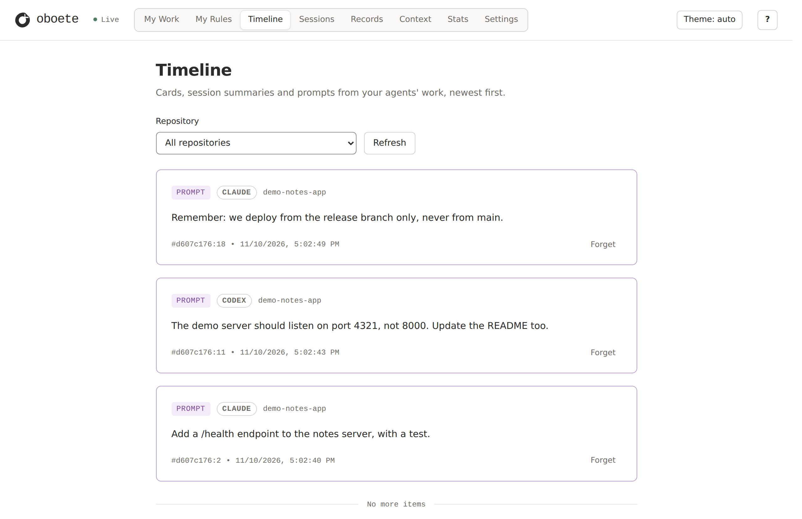
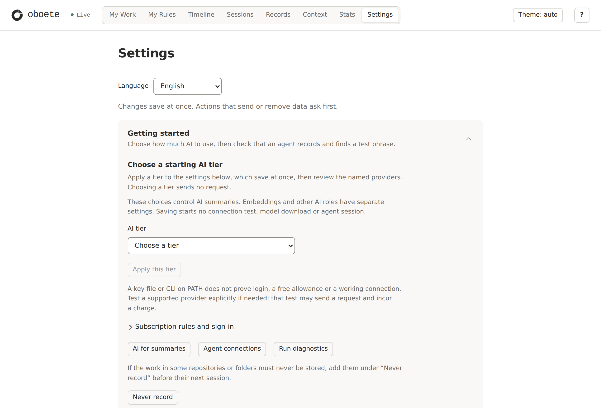
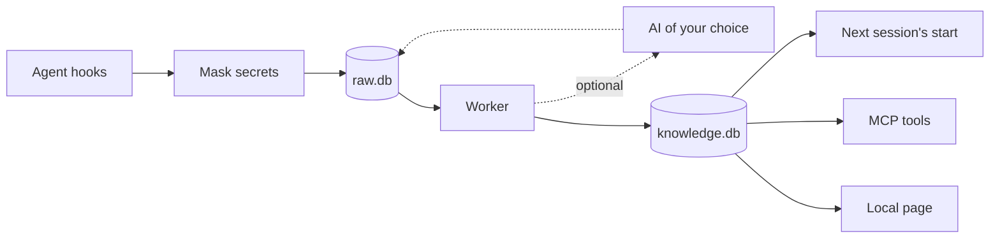

<p align="center">
  <picture>
    <source media="(prefers-color-scheme: dark)" srcset="assets/brand/logo/oboete-logo-light.svg">
    
  </picture>
</p>

<p align="center"><em>Your coding agents forget between sessions. oboete remembers, on your machine.</em></p>

<p align="center">
  <a href="https://github.com/ojungo69/oboete/actions/workflows/ci.yml"></a>
  <a href="LICENSE"></a>
  
</p>

<p align="center"><b>English</b> | <a href="README.ja.md">日本語</a></p>

**oboete** (覚えて, Japanese for "remember this") is one Rust binary that records what your coding
agents do, keeps it in SQLite files on your own disk, and gives the next session what the last one
left behind. You can search it from the terminal, from the agent itself over MCP, or on a local web
page. oboete itself sends nothing anywhere until you turn on AI summaries or an online embedder;
what it hands to an agent becomes part of that agent's own conversation.

It works with **Claude Code**, **Codex** and **Grok Build**, the three the maintainer runs every
day. Adapters for Cursor, OpenCode, Antigravity and Pi are built and tested, and have not been used
in live sessions yet.

This is a new Claude Code session, the day after, in a repository where Claude Code and Codex
worked the day before. No AI summarized any of it: it is what was recorded.

```console
$ claude
## Owner's directives
- 2026-11-10 (unverified) "Remember: we deploy from the release branch only, never from main."
## Last exchange
- prompt: Remember: we deploy from the release branch only, never from main.
- reply: Noted: deploys go out from the release branch only, never from main.
## Files touched
- README.md
- src/server.py
## As of
2026-11-10 08:02 UTC

oboete: memory is on. This repository's latest state was handed over. Open the page with: oboete view --open

$ oboete search "port 4321"
d607c176:15 2026-11-10 08:02 UTC reply (citable) — The server now listens on port 4321, and the README says so.
d607c176:11 2026-11-10 08:02 UTC prompt (citable) — The demo server should listen on port 4321, not 8000. Update the README too.
```

The same repository on the local page: what Claude Code and Codex were asked, in one timeline.

<p align="center">
  <picture>
    <source media="(prefers-color-scheme: dark)" srcset="docs/images/timeline-dark.png">
    
  </picture>
</p>

> [!NOTE]
> oboete is pre-release. You build it from source, there is no tagged release yet, and its file
> formats may still change. It is used every day on Linux (WSL); on macOS and Windows the test
> suite runs in CI.

## What you get

- **A record of every session.** Prompts, replies, tool calls and their results, from each agent,
  in one store. A field over 64 KB keeps its head and tail, and an image is kept as a marker. A
  hook does not fail the agent: it waits at most two seconds for the store, and if the store is
  busy or the write fails, the event is kept in a file and written by a later hook.
- **A start that is not from zero.** A new session is handed what the last one in that repository
  and branch left: the last exchange, the last failing command, risky git state (uncommitted
  changes, a rebase in progress), the files touched, the lines you gave as directives and the open
  to-do lists.
- **Notes while the agent works.** The session start is not the only moment a hook adds to the
  agent's context. When the agent looks into its own memory files, a hook answers with what oboete
  has on those words; when something handed over earlier has since changed, the next prompt says
  so (both can be switched off under `[inject]` in `~/.oboete/config.toml`). Reading a file that
  earlier work names, in a card written by AI summaries or in history imported from claude-mem,
  gets a short note of it.
- **Search in any script.** Full-text search over your prompts and replies, Japanese included, with
  no tokenizer to set up: words are matched by their 3-character pieces. From the terminal
  (`oboete search`), or by the agent itself through nine MCP tools. Tool output is kept and can be
  read by its id (`oboete get`), but it is not searched.
- **A page to look at it.** `oboete view --open` serves a page on `127.0.0.1` only: a timeline,
  sessions, raw records, exactly what the next session will be given, and the settings.
- **Secrets masked before they are stored.** By default, text goes through 217 of
  [gitleaks](https://github.com/gitleaks/gitleaks)' rules and 25 of oboete's own before it is
  written, and again before anything is sent out. `<private>…</private>` in a prompt is never
  stored. Masking is pattern matching: it catches what the rules match, not every secret.
- **Forget.** `oboete forget` erases the text of records, what was made from them and their backup
  copies, after a preview. It cannot take back what was already sent to an AI or handed to an
  agent, and it leaves the agent's own transcript files alone. You can also keep a repository or a
  folder from being recorded at all.
- **Optional AI summaries.** Turn them on and an AI of your choice writes cards, summaries and
  short claims (decisions, preferences, lessons, fixes, open items), each claim with the quote it
  came from. Search then covers those too.

## Quick start

You need a stable Rust toolchain, 1.95 or newer (from [rustup](https://rustup.rs); open a new shell
afterwards so `~/.cargo/bin` is on your `PATH`), a C compiler and git.

```sh
# 1. Build and install the binary (into ~/.cargo/bin)
cargo install --git https://github.com/ojungo69/oboete --locked oboete

# 2. Wire it into your agent: claude, codex, grok, cursor, opencode, agy, pi, or all
oboete setup claude

# 3. Check the wiring
oboete doctor
```

Restart your agent, since hook files are read when it starts. With Claude Code, a new session in a
repository then shows this line (other agents get the memory without a line):

```text
oboete: recording is on. This repository has no memory to hand over yet. Open the page with: oboete view --open
```

The line is in English or Japanese, following your system's language.

Work as usual. The next new session in that repository, on the same branch, starts with what the
last one left; a resumed session already has its context and gets nothing new. Inside the
repository, `oboete search <words>` finds what was said (`--all` searches every repository). A
background worker prepares both a moment after each event, so the first seconds can still come up
empty.

- On Linux, `setup` also turns on a small resident worker and the page at `127.0.0.1:17373`. They
  start with your first agent session and stay up between sessions; `oboete setup all --remove`
  turns them off.
- On macOS and Windows the worker exits when idle, and `oboete view --open` serves the page in the
  foreground until you press Ctrl-C.
- Run `oboete setup` from the installed binary, not from a build directory: the hooks call the
  binary by the path `setup` was run from. To move to a binary at another path later, run
  `oboete setup <agent> --remove` with the old one, then `oboete setup <agent>` with the new one.

## Supported agents

| Agent | Set up with | How it connects | Status |
|---|---|---|---|
| Claude Code | `oboete setup claude` | 9 hooks, MCP server | used daily by the maintainer |
| Codex | `oboete setup codex` | 8 hooks, MCP server | used daily by the maintainer |
| Grok Build | `oboete setup grok` | 8 hooks, MCP server | used daily by the maintainer |
| Cursor | `oboete setup cursor` | 7 hooks, MCP server | tested, not used live yet |
| Antigravity (`agy`) | `oboete setup agy` | 4 hooks, MCP server | tested, not used live yet |
| OpenCode | `oboete setup opencode` | plugin, MCP server | tested, not used live yet |
| Pi | `oboete setup pi` | extension with its own tools | tested, not used live yet |

All agents write to the same store, so what Codex did yesterday is there for Claude Code today.

- `oboete setup` prints "not yet checked in a live session" for every agent, the first three
  included: that line follows a formal checklist of each injection point, which has not been run
  yet.
- `setup` skips Cursor, Antigravity, OpenCode and Pi, and says so, when the agent is not installed.
  For Cursor, approve the MCP server once in each project with `agent mcp enable oboete`.
- Claude Code, Codex and Grok Build are wired whether or not they are installed: their
  configuration files are made if missing. Name the agents you use rather than `all`.
- What `setup` writes outside `~/.oboete`, for the three used daily:
  - Claude Code: hooks in `~/.claude/settings.json`, and an MCP server registered by running
    `claude mcp add-json --scope user`. If `claude` is not on your `PATH`, the hooks are written
    and `setup` says the MCP server was skipped.
  - Codex: `~/.codex/hooks.json`, and in `~/.codex/config.toml` the MCP server and a trust entry
    for each of oboete's hooks, so Codex runs them without asking you to review them first.
  - Grok Build: `~/.grok/hooks/oboete.json` and the MCP server in `~/.grok/config.toml`.
- The hooks are user-wide: every repository you work in is recorded unless you exclude it
  (`oboete capture exclude`).
- `oboete setup <agent> --remove` takes oboete's entries out of that agent's configuration and
  leaves the rest as it was. The first `setup` keeps a `.oboete.bak` copy of each file it edits.
- An agent with no adapter can still be recorded: point its hook events at
  `oboete hook <name> <Event>` ([docs/raw-adapter.md](docs/raw-adapter.md)). It is recorded and
  searchable, and is handed no memory.

## What stays on your machine

- **Everything, by default.** A fresh install calls no AI and sends nothing: summaries are off and
  search is full-text. oboete sends no telemetry.
- **What is handed to an agent goes where the agent goes.** The session start, the notes and what
  the agent reads through the MCP tools become part of that agent's conversation, and so reach the
  service that agent talks to, as the rest of your work with it does. To keep something out of
  it: `<private>…</private>` in a prompt is never stored, `oboete capture exclude` records nothing
  of a repository or folder, and the hand-over at session start can be switched off in Settings.
- **Your data is files you own.** `~/.oboete` holds SQLite databases (`raw.db` for the record,
  `knowledge.db` for what is made from it). `--home <dir>` or `OBOETE_HOME` puts them elsewhere:
  give the same value to `setup` and to every later command.
- **It grows.** Everything is kept by default; the maintainer's `raw.db` is about 4 GB, with
  compressed backup copies beside it in `~/.oboete/backups`. A
  retention period (Settings, or `[retention] days`) removes the text of older raw records once
  their sessions have been summarized.
- **The page is local.** The viewer binds to `127.0.0.1` only and needs the token in the address
  that `oboete view` prints.
- **You choose what leaves.** If you turn on summaries or an online embedder, text is masked again
  with your current rules before it is sent. `oboete exclude` keeps a repository's sessions from
  every AI from then on; what was sent before stays sent. Masking itself can be switched off in
  Settings. With `[summary] conversation = true` in `config.toml` (off unless you set it), a
  summarizing AI on Anthropic's API is sent the same lines again with each later call of a
  conversation, and keeps them in its prompt cache until five minutes after the last one
  ([docs/prompt-cache.md](docs/prompt-cache.md)).
- **No encryption at rest.** The files are as private as your disk: use your operating system's
  disk encryption.

## Optional: AI summaries

Summaries are off until you pick an AI tier in the page's settings (`oboete view --open`,
**Settings**), which names each AI service; choosing a tier sends nothing by itself.

<p align="center">
  <picture>
    <source media="(prefers-color-scheme: dark)" srcset="docs/images/settings-dark.png">
    
  </picture>
</p>

With summaries on, the worker sends recent records to that AI and stores what comes back:

- **Cards**: what was done, in a title and a few facts.
- **Summaries**: for each turn, the request, what was looked into, what was learned, what was
  completed and what comes next.
- **Claims**: short statements, each a decision, preference, lesson, fix, open item, repo fact or
  change. A claim holds the exact quote it came from and points at the record; a draft whose quote
  cannot be found in the record is dropped.
- **My Work**: a page of your requests and what each produced. It lists them without any AI; a
  switch of its own lets an AI group and review them.

Who can do the work:

- **Free tiers** (Groq, OpenRouter, NVIDIA NIM), with your own key from that service. On Linux you
  paste the key into the page, which saves it as a file only you can read in
  `~/.local/share/oboete/keys/`, outside `~/.oboete`. On macOS and Windows the page cannot save a
  key yet: put it on line 2 of `~/GROQ_API_KEY.md`, `~/OPENROUTER_API_KEY.md` or
  `~/NVIDIA_NIM_KEY.md`.
- **A Claude or Codex subscription**, through its own CLI, which spends the quota you code with.
  The CLI reads text that is not yours, so oboete runs it only when it can show the CLI cannot act:
  Claude Code's tools are checked on every call, and Codex is probed before each call. A Codex
  release that turns on a feature or offers a tool oboete has not reviewed stops Codex summarizing
  until oboete has reviewed it.
- **An API key of your own** (Anthropic, or any OpenAI-compatible endpoint), under a monthly cap
  you set.

## Optional: search by meaning

Full-text search is the default. For search by meaning, build with a local embedding model:

```sh
cargo install --git https://github.com/ojungo69/oboete --locked --features local-embed oboete
oboete setup --embeddings local
```

`setup` lists what it will download and asks before it starts: about 2.3 GB once, the
[BGE-M3](https://huggingface.co/BAAI/bge-m3) model and the ONNX Runtime library, kept beside your
data. After that the model runs on your machine. It runs on Linux (x86_64 and arm64), Apple-silicon
Macs and Windows (x86_64).

The worker then embeds your records in the background, starting with your next agent session. Your
agents search by meaning through the MCP tools; in the terminal, add `--vectors`
(`oboete search --vectors <words>`).

## Coming from claude-mem

oboete follows the design of [claude-mem](https://github.com/thedotmack/claude-mem) closely, and
reads its database:

```sh
oboete import claude-mem ~/.claude-mem/claude-mem.db
```

- The import reads claude-mem's database without changing it, and adds its observations, session
  summaries, prompts and work state to oboete. It can be run again: each row comes in once. The
  images claude-mem keeps (15.7.0 and later) are not brought over.
- It also reads the `settings.json` beside the database, and the folders claude-mem was told to
  leave out (`CLAUDE_MEM_EXCLUDED_PROJECTS`) become folders oboete does not record.
- It reads databases of claude-mem 13.28.0 to 15.15.0. A database from a newer claude-mem is
  refused, with nothing imported, until oboete catches up.
- What was imported becomes searchable when the worker next runs. `oboete search --all` searches
  the history of every project.
- claude-mem keeps working beside oboete. While both are installed, each session start carries
  both memories' context.

[docs/claude-mem-parity.md](docs/claude-mem-parity.md) compares the two row by row, including the
rows where oboete is still behind.

## How it works



Hooks append to `raw.db` and return, then start a worker if none is running. The worker builds the
search index and the next session's packet in `knowledge.db`, usually within seconds, and, if you
turned them on, asks an AI for summaries. What an AI wrote is saved in `raw.db` too, so
`knowledge.db` can be rebuilt from `raw.db` (`oboete rebuild`) with no AI call.

## Measured

On the maintainer's machines; each figure with where it comes from.

| What | Figure | Conditions |
|---|---|---|
| One hook, started as a process, writing a 1 KB event | 10.5 ms p50, 12.1 ms p95 on WSL; 19.9 / 22.8 ms on Windows; 21.9 / 25.2 ms on an M1 iMac | 300 spawns, release build, 2026-09-27 ([docs/milestone-2.md](docs/milestone-2.md)) |
| The session-start hook | 135 ms median, against 305 ms for claude-mem's in the same sessions | 10 session starts timed by Claude Code, a 4 GB store, to 2026-10-17 ([parity table](docs/claude-mem-parity.md), row X2) |
| The resident worker | about 18 to 19 MiB of memory over 5,000 prompts; 0.42 CPU-seconds in 10 idle minutes | WSL, synthetic data, no AI calls, 2026-10-04 ([docs/resident.md](docs/resident.md)) |

## Commands

| Command | What it does |
|---|---|
| `oboete setup <agent>` | Wire an agent's hooks and MCP server (Pi: an extension), or take them out with `--remove` |
| `oboete doctor` | Report wiring, stored data and provider readiness |
| `oboete view --open` | Open the local page and print its address |
| `oboete search <words>` | Search this repository's memory (`--all` for every repository) |
| `oboete timeline` | Claims, imported history and session starts, newest first |
| `oboete get <id>…` | Print chosen items in full, tool records included |
| `oboete forget --repo <dir>` | Erase text for good, after a preview and a confirmation (also `--record`, `--session`, `--uid`, `--since` with `--until`) |
| `oboete exclude` / `oboete capture exclude` | Stop sending a repository's sessions to any AI from now on, or stop recording a repository or folder |
| `oboete backup list`, then `oboete restore --to <time>` | List the backup points and preview going back to one; `--yes` with the time the preview prints goes back |
| `oboete import claude-mem <db>` / `oboete import transcripts` | Import claude-mem's database; or Claude Code and Codex transcripts, as a preview until you add `--yes` |

`oboete <command> --help` describes each one.

## Status and limits

Built and working: recording, the session start, full-text search (hybrid search with an embedder
turned on), the MCP tools, the page with its settings, masking, forget, backups with restore
points, AI summaries, My Work, and the claude-mem import.

Not built yet:

- Release binaries, an installer and `oboete update`. You build from source.
- Sync between machines.
- The resident worker, the always-reachable page and saving a key from the page on macOS and
  Windows.
- An export of your memory to files.

oboete is the wrong tool if you want a hosted memory service, team-wide shared memory, or a
library to add memory to your own LLM application. It is a local tool for one developer's coding
agents.

## Uninstall

Run the first command while the binary is still installed: it also stops the worker and the page.

```sh
oboete setup all --remove   # take oboete's entries out of every agent it finds
cargo uninstall oboete
rm -rf ~/.oboete            # your recorded memory: only if you want it gone
```

If you gave another folder with `--home` or `OBOETE_HOME`, that folder holds your memory, not
`~/.oboete`.

What these leave behind:

- The `.oboete.bak` copies that `setup` made beside your agents' configuration files.
- Keys you saved from the page: `~/.local/share/oboete/keys/` (or `~/.oboete-keys/`). Key files
  you wrote yourself (`~/*_KEY.md`) are yours and are never touched.
- Claude Code's MCP entry, if `claude` was not on your `PATH` when you ran the first command:
  take it out with `claude mcp remove --scope user oboete`.

## Documentation

- [docs/spec.md](docs/spec.md): the design, its decisions and milestones.
- [docs/claude-mem-parity.md](docs/claude-mem-parity.md): oboete and claude-mem, feature by feature.
- [docs/](docs): the design notes, milestone reports and measurements behind each feature.

Issues and pull requests are welcome. If oboete is useful to you, a star helps others find it.

## Acknowledgements

oboete owes its shape to [claude-mem](https://github.com/thedotmack/claude-mem) by Alex Newman.
Secret detection uses the rules of [gitleaks](https://github.com/gitleaks/gitleaks). Local search by
meaning uses [BGE-M3](https://huggingface.co/BAAI/bge-m3). See [NOTICE](NOTICE).

## License

[Apache-2.0](LICENSE)
